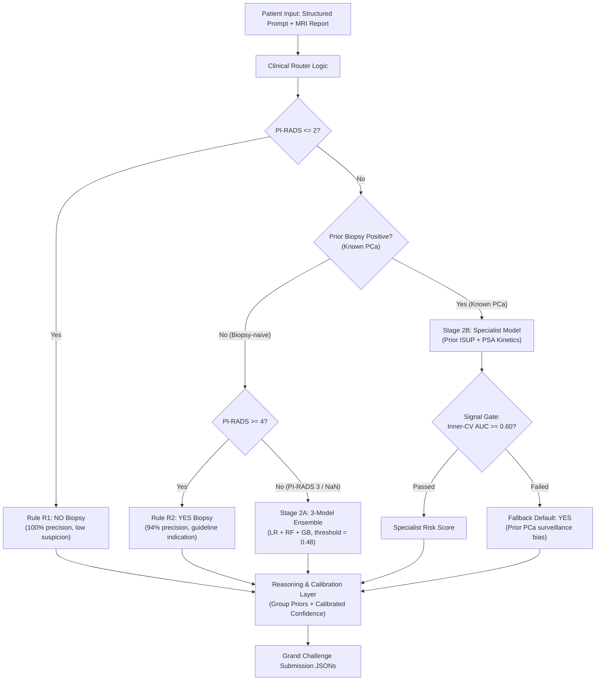

# CHIMERA Task 1: Clinical-Context Router (Variant B)

Official algorithm and evaluation repository for **Task 1: MRI-Only Diagnostic Decision (Biopsy Yes / No)** of the [CHIMERA Grand Challenge](https://chimera-agent.grand-challenge.org/).

This repository implements the **Variant B Clinical-Context Router**, an architecture that routes patients through guideline-derived clinical rules, a calibrated 3-model ensemble, and a signal-gated specialist model. It achieves an official **Task 1 Ranking Score of 0.7028** on the labeled benchmark cohort under repeated 5-fold cross-validation.

---

## 1. Architecture Overview

Rather than forcing a single model or LLM to handle fundamentally disparate patient populations, the **Clinical-Context Router** partitions patients into clinical strata:



---

## 2. Official CHIMERA Benchmark Results

Evaluated using the official [`evaluate.py`](evaluation/evaluate.py) logic across all 91 labeled cases using **5-Fold Stratified Cross-Validation (5 Repeats)**:

| Model Architecture | Task 1 Ranking Score | Mean Case Score | Biopsy $F_1$ | Decision Accuracy | Variable Weight Score | Tool Efficiency Score |
| :--- | :---: | :---: | :---: | :---: | :---: | :---: |
| **Variant B Router (`route_honest`)** | **0.7028** | **0.5903** | **0.8154** | **73.63%** | **0.8768** | **0.9900** |
| Variant B Router (`route_data`) | 0.7025 | 0.5896 | 0.8154 | 73.63% | 0.8768 | 0.9900 |
| Variant B Router (`global` reasoning) | 0.7034 | 0.5914 | 0.8154 | 73.63% | 0.8624 | 0.9940 |
| Variant B Router (No Specialist) | 0.6766 | 0.5521 | 0.8012 | 69.45% | 0.8772 | 0.9842 |
| Baseline Ensemble ($t=0.48$) | 0.6537 | 0.5346 | 0.7727 | 67.03% | 0.8689 | 1.0000 |
| Baseline Ensemble ($t=0.67$) | 0.6222 | 0.5556 | 0.6889 | 67.03% | 0.8689 | 1.0000 |
| Attribution Baseline | 0.5568 | 0.4246 | 0.6889 | 67.03% | 0.5527 | 0.6044 |

> [!NOTE]
> Task 1 official ranking score formula: $\text{Task 1 Score} = \frac{\text{Mean Case Score} + \text{Biopsy } F_1}{2}$. Wrong decisions receive an immediate case score of $0$, making decision accuracy the primary performance driver.

---

## 3. Repository Structure

```text
├── Dockerfile                  # Grand Challenge offline submission container
├── do_build.sh                 # Docker build script
├── do_test_run.sh              # Local test run script
├── do_save.sh                  # Exports container tarball for Grand Challenge upload
├── inference.py                # Container entry point (/input -> /output)
├── requirements.txt            # Python dependencies
├── data/
│   ├── features.csv            # Raw clinical features and reports
│   ├── features_clean.csv      # Preprocessed feature matrix
│   ├── feature_lists.json      # Feature column definitions
│   ├── reasoning_audit.csv     # Pathologist reasoning audit annotations
│   └── ground_truth/task1/     # Per-case ground truth JSONs for local validation
├── evaluation/
│   ├── evaluate.py             # Official CHIMERA evaluation logic
│   └── section_variable_mapping.json
├── src/
│   ├── router.py               # Core Clinical-Context Router architecture
│   └── reasoning.py            # Group-specific priors, confidence, and rationales
└── scripts/
    ├── benchmark_variant_b.py  # 5-fold CV (5 repeats) benchmark for Variant B
    ├── benchmark_ensemble.py   # Benchmark for 3-model ensemble
    └── evaluate_predictions.py # CLI evaluator for prediction folders
```

---

## 4. Quick Start (Native Python)

### 1. Installation
```bash
git clone https://github.com/DevKansara97/CHIMERA-Task1-Clinical-Router.git
cd CHIMERA-Task1-Clinical-Router

python3 -m venv .venv
source .venv/bin/activate
pip install -r requirements.txt
```

### 2. Run the Official Benchmark (Variant B)
```bash
python scripts/benchmark_variant_b.py
```
This runs 5 repeats of 5-fold CV, outputs the scorecard, and exports official Grand Challenge format predictions to `results/predictions/variant_b_router/task1/`.

### 3. Evaluate Predictions Directory
```bash
python scripts/evaluate_predictions.py \
  --pred results/predictions/variant_b_router/task1/ \
  --gt data/ground_truth
```

---

## 5. Docker Deployment (Grand Challenge)

The container is lightweight, offline, requires no GPU/VRAM, and complies with the Grand Challenge runtime contract.

### 1. Build Container Image
```bash
./do_build.sh
```

### 2. Test Container Locally
```bash
./do_test_run.sh
```
Reads sample input from `test/input/` and writes `prostate-biopsy-decision.json` and `prostate-biopsy-decision-reasoning.json` to `test/output/`.

### 3. Package for Grand Challenge Upload
```bash
./do_save.sh
```
Exports `chimera-task1-router.tar.gz` ready to be uploaded to your Grand Challenge Algorithm page.
